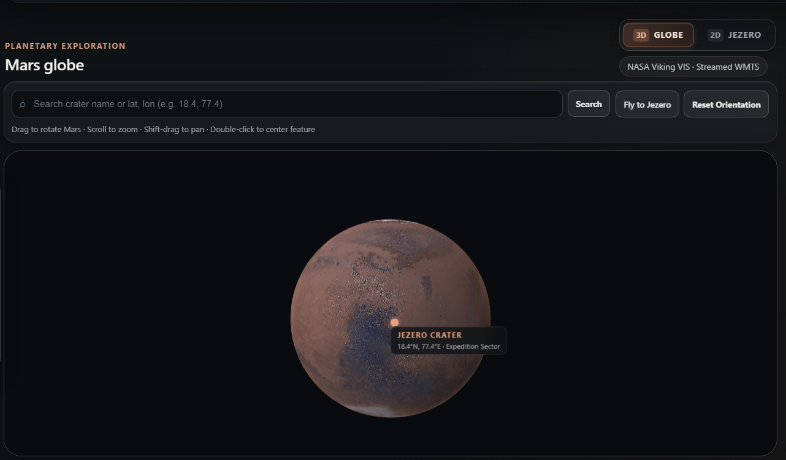
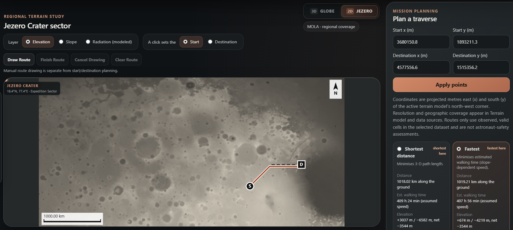
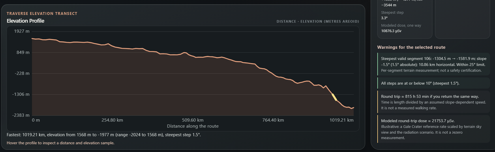

# Interplanetary Survival Guide: Martian Map

Mars Survival is a route planning tool designed for exploring Jezero Crater on Mars. It helps compare possible walking routes between two locations and shows the distance, travel time, elevation changes, terrain difficulty, estimated radiation exposure, and resource requirements for each route.

The project was built for the NASA Space Apps Challenge. It is an educational terrain exploration and route planning prototype, not flight software, and it is not endorsed by NASA.

## What the project actually does

The application combines real Mars imagery and elevation datasets with terrain analysis and route planning. It allows users to explore Mars in 3D, switch to a detailed 2D map of Jezero Crater, select locations, inspect terrain information, and compare routes using different objectives.

It is important to distinguish between measurements calculated from real data and estimates based on assumptions.

| Data or feature | Current implementation |
|---|---|
| Elevation, slope, distance, and elevation gain | Calculated from the loaded terrain model using its actual pixel spacing |
| Regional elevation | NASA MOLA MEGDR, product MEGT44N000HB |
| Global Mars imagery | NASA Mars Trek Viking VIS imagery, loaded through WMTS |
| Jezero high resolution terrain | NASA HiRISE DTM, derived from a 1 m per pixel source |
| Jezero CTX elevation | Processed 20 m DEM tiles with manual route sampling |
| Radiation exposure | Estimated using a reference rate measured by Curiosity at Gale Crater and a terrain horizon model |
| Temperature, pressure, and dust | User selected scenarios, not live Jezero observations |
| Walking speed and endurance | Assumed values that can be adjusted |
| Science targets | Targets supplied with a terrain tile; bundled targets are fictional |

The radiation, environmental, and resource calculations are estimates. They should not be interpreted as predictions of actual astronaut safety.

## Screenshots

### Mars Globe


### Jezero Crater Exploration & Route Planning


### Mission Control


## Features

### Mars exploration

The application includes an interactive 3D Mars globe using global Viking VIS imagery from NASA Mars Trek. Users can rotate the globe, zoom in, pan, and search for locations.

The same workspace also provides a 2D Jezero Crater terrain view. Users can switch between the two views without opening a separate application.

### Terrain data

Three elevation sources are available:

**MOLA MEGDR**

The regional elevation layer uses NASA's MEGT44N000HB product. The original PDS3 IMG and label files were decoded and checked against the source metadata. The resulting planner grid has approximately 7.872 km spacing per cell.

Its source coverage is 0 to 90 degrees east longitude and 0 to 44 degrees north latitude.

**HiRISE DTM**

The Jezero Field Lab includes the real HiRISE product DTEEC_045994_1985_046060_1985_U01. Its original terrain data has a resolution of 1 m per pixel. A smaller 333 by 713 grid, with approximately 20 m spacing, is used by the route planner.

This provides more detailed local terrain analysis within the mapped footprint, approximately 6.4 by 14.4 km. Areas without elevation data remain marked as no data.

**CTX DEM**

The application also includes a collection of 99 processed CTX elevation tiles derived from a separate 20 m Jezero DEM.

These tiles can be loaded when CTX is selected and used to sample elevation along manually drawn routes. Automatic CTX route planning is not implemented. The source vertical reference has not been fully established, so its limitations are disclosed in the application.

Production use of this dataset requires a configured CTX_TILE_BASE_URL.

### Route planning

The planner uses Dijkstra's algorithm on an eight connected terrain grid. It compares four route objectives:

1. **Shortest:** Finds the route with the lowest three dimensional travel distance.
2. **Fastest:** Favours routes with lower estimated walking time, accounting for slope.
3. **Lower risk:** Considers slope and modeled radiation exposure.
4. **Science:** Favours routes that pass near available science targets.

The planner avoids cells above the configured slope limit, which defaults to 25 degrees, and cells without valid elevation data. Diagonal movement through blocked corners is also prohibited.

If no valid route exists, the application reports that instead of displaying an invalid path.

For each route, the application calculates:

- Total distance
- Estimated travel time
- Ascent and descent
- Net elevation change
- Steepest terrain step
- Modeled radiation dose
- Elevation profile and terrain warnings

These results are intended for comparing routes within the available terrain data, not for selecting a certified safe route.

### Resource estimates

The application includes a resource calculator with adjustable assumptions. It estimates round trip duration and consumable use based on travel time and the selected endurance values.

The calculations are displayed so users can see how the estimates are produced. Passing the resource criteria does not mean a route is safe for a real mission.

### Map tools and interface

Other available features include:

- Independent imagery and elevation layer selectors
- Location search and coordinate readout
- Scale bar and north arrow
- Terrain legends with measurement units
- Elevation profiles
- Route warnings with explanations
- Keyboard controls
- Responsive layout for smaller screens
- Data and Sources panel with dataset details, coverage, resolution, attribution, and limitations

Changing the visible imagery does not change the elevation data or route calculations.

## How the calculations work

The route planner uses the horizontal distance between neighbouring grid cells and the elevation difference between them.

For a movement between two cells:

- Horizontal distance is calculated from the actual grid spacing.
- Three dimensional distance is calculated as the square root of horizontal distance squared plus elevation difference squared.
- Slope is calculated from the elevation difference and horizontal distance.

The four route objectives use the following costs:

**Shortest route**

Minimizes the total three dimensional distance.

**Fastest route**

Uses an assumed walking speed of 2.5 km/h, adjusted according to slope:

v(s) = v₀ × exp(−(s / 16°)²)

**Lower risk route**

Uses a combination of slope and modeled radiation exposure:

Cost = L × (1 + (s / 10°)² + 3 × SVF)

Here, SVF represents the sky view factor. The risk calculation considers slope and modeled radiation only. It does not represent every possible hazard.

**Science route**

Reduces the estimated travel cost near science targets using a 250 m Gaussian proximity function.

Travel times are calculated consistently across all four objectives, allowing their results to be compared on the same basis.

Radiation dose is estimated using a reference rate of 0.64 mSv per day measured at Gale Crater, adjusted by the sky view factor and the selected scenario multiplier.

The resource calculator estimates round trip use from the selected travel time and endurance assumptions. All model constants and assumptions are available in the application.

## Running the project

The application requires Node.js 20 or later for the test suite and Python 3 with NumPy for the data processing tools.

Run the following commands from the project directory:

```bash
npm test
python3 test/ui_test.py
python3 tools/build_dist.py
```

The browser tests require Playwright and Chromium:

```bash
pip install playwright
playwright install chromium
```

### Running with Rails

The application uses Rails 7.1.6 and Ruby 3.3.

```bash
bundle install
bin/rails server
```

Open http://localhost:3000.

To generate the static export:

```bash
bin/rails static:export
```

The static export can also be generated using tools/build_dist.py.

### Data files and builds

The build can regenerate the MOLA planner grid from:

- data/raw/mola/megt44n000hb.img
- data/raw/mola/megt44n000hb.lbl

The HiRISE planner grid can be regenerated from the original DTM and its matching orthomosaic label.

Raw raster files are excluded from Git because of their size. The processed MOLA and HiRISE planner grids are included under public/data, allowing the application to run without the original raw files.

## Known limitations

There are several limitations worth keeping in mind:

- MOLA has approximately 7.9 km grid spacing, which is too coarse for detailed local walking hazard analysis.
- The HiRISE planner grid has approximately 20 m spacing and covers only a small part of Jezero Crater.
- Neither terrain grid captures every small obstacle, rock, or surface hazard.
- CTX supports manual route sampling, but automatic CTX route planning is not available.
- The production CTX tile collection needs external hosting.
- The CTX vertical reference remains unresolved.
- The sky view factor calculation samples terrain at intervals on finer grids to limit processing time. It may miss narrow terrain features.
- The radiation reference comes from Gale Crater, not Jezero Crater.
- Temperature, pressure, and dust values are scenario inputs rather than observations from Perseverance's MEDA instrument.
- Walking speed, endurance, slope limits, and resource reserves are assumptions.
- USGS geology, CRISM, THEMIS, and MEDA datasets have not yet been integrated into the application.
- Regional CTX and HiRISE optical mosaics are not currently rendered.
- No live Jezero weather observations are provided.

The application is a research and educational prototype. Its results should not be used to make real mission safety decisions.

## Tests and validation

The Node.js test suite covers terrain geometry, MOLA and HiRISE data processing, CTX tile loading and sampling, route calculations, no data handling, WMTS parsing, layer selection, and build consistency.

The browser test suite checks the main interface and map layer behaviour, including imagery and elevation independence, MOLA and HiRISE selection, CTX loading and retry behaviour, route preservation, and mobile controls.

## Credits and licences

The project code is released under the MIT License.

Data sources and acknowledgements:

- NASA and the MOLA MEGDR dataset
- NASA Mars Trek and Viking VIS imagery
- NASA/JPL-Caltech/University of Arizona HiRISE terrain products
- NASA CTX elevation data
- Curiosity Radiation Assessment Detector reference measurements, including Hassler et al. (2014)

Additional dataset references and attribution details are available in DATA_SOURCES.md. Information about the use of AI tools is provided in AI_USAGE.md.

**Project status:** A working Mars terrain exploration and route planning prototype, built around real planetary datasets with clearly identified assumptions and limitations.
